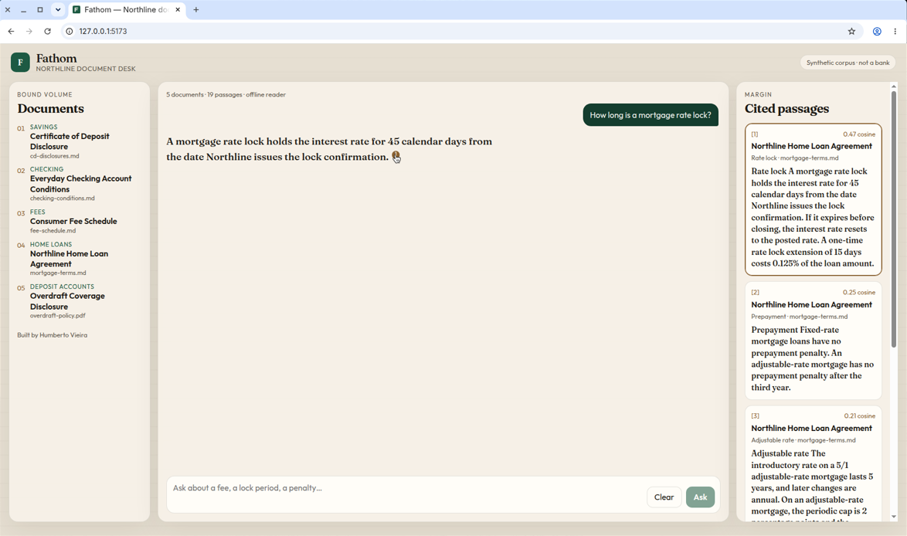
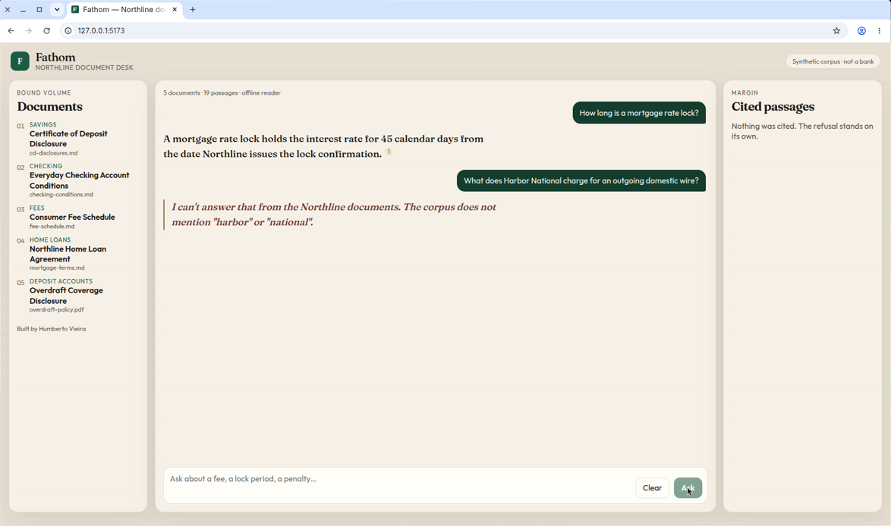
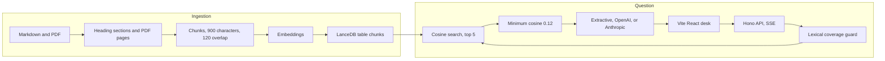

# Fathom

[](https://github.com/hjsvieira98/bank-docs-rag/actions/workflows/ci.yml)

Fathom is a retrieval-augmented assistant for a small set of **fictional** banking documents. Ask about a rate lock, a fee, or a penalty and the answer quotes the clause, with the passage sitting in the margin. If the corpus does not contain the answer, Fathom refuses.

Northline Bank does not exist. Every document under `corpus/` was written for this project and is marked fictional. Nothing here is financial, legal, or compliance advice, and nothing here has been used in production.

Built by [Humberto Vieira](https://github.com/hjsvieira98).





## What you can do with it

- Read five synthetic documents: a home-loan agreement, checking conditions, a fee schedule, a certificate-of-deposit disclosure, and a one-page overdraft PDF.
- Ask a question in the browser. The answer streams, and each `[n]` chip highlights the chunk it came from.
- Stay offline. The default path uses a local embedder and an extractive reader, so `npm install` and `npm run dev` need no API key.
- Swap the reader for OpenAI or Anthropic, and the embedder for OpenAI, with environment variables. Anthropic has no embeddings API, so chat and embeddings are separate settings.
- Re-run a fixed evaluation set that scores retrieval and whether the answer contains the expected facts.

## Architecture



A question is refused before the reader runs when it is empty, when a content word of five or more letters is missing from the indexed vocabulary, or when the best cosine score is below `0.12`. Hosted readers can also return the sentinel `NOT_IN_DOCS`, which the API turns into a refusal and does not cite.

## Decisions

**LanceDB, on disk, no Docker.** The index is a local table at `data/index/lancedb`. `npm install` is enough to ingest and search, and CI does not start a database. pgvector would be the better shared store once more than one process writes the index; the `VectorStore` interface is the seam for that adapter. LanceDB's default metric is L2. Search asks for cosine distance, and the score shown in the UI is `1 - distance`.

**A local hashing embedder by default.** `local-hash-384-v1` is 384-dimensional signed feature hashing with TF-IDF weights, L2-normalized, fit on the corpus at ingest time. It is deterministic, so tests and evals do not call a network. It is a lexical-semantic stand-in, not a neural embedding model. Set `EMBEDDING_PROVIDER=openai` to use `text-embedding-3-small`. Switching models changes the model id stored in `manifest.json`, and the next start rebuilds the index.

**Section-sized citations.** Markdown is split on the heading path. A section longer than 900 characters is packed into windows with 120 characters of overlap. A PDF page is one section (`Page N`). The citation unit is that chunk, which is why the margin can show "Rate lock" rather than an arbitrary token window. Blockquote disclaimers stay in the source files and are stripped before indexing, so the fictional banner is not retrieved.

**Thin HTTP clients for hosted models.** OpenAI chat, OpenAI embeddings, and Anthropic messages are `fetch` plus server-sent events. No vendor SDK is in the dependency tree. Temperature is 0. The system prompt requires a bracket citation on each claim and the exact sentinel `NOT_IN_DOCS` when the sources do not contain the answer.

**Refusal in front of generation.** The interesting near miss in this corpus is "What does Harbor National charge for an outgoing domestic wire?". Retrieval still returns the Northline fee schedule at cosine `0.359`, which is above the `0.12` floor. The lexical guard refuses it because `harbor` and `national` are not in the vocabulary. The floor stays at `0.12` on purpose: this local embedder separates the current set more widely than a hosted embedding model will, and a threshold tuned to today's scores would not travel.

**An extractive reader for the offline path.** It quotes the retrieved sentence with the strongest content-word overlap and appends `[n]`. Dev mode sets `STREAM_DELAY_MS=12` so that sentence still streams word by word. Hosted models use the same retrieved chunks and the same citation contract.

## Layout

| Path              | Role                                                                                  |
| ----------------- | ------------------------------------------------------------------------------------- |
| `packages/core`   | Chunking, embeddings, LanceDB and in-memory stores, prompts, readers, the answer loop |
| `packages/ingest` | Markdown and PDF loaders, corpus stamp, manifest                                      |
| `apps/api`        | Hono server. `GET /api/health`, `GET /api/documents`, `POST /api/chat` as SSE         |
| `apps/web`        | Vite + React desk. The dev server proxies `/api` to port 8787                         |
| `corpus`          | Fictional Northline documents, including `overdraft-policy.pdf`                       |
| `evals`           | 18 questions, metric definitions, `npm run eval`                                      |
| `scripts`         | `ingest.ts`, `generate-sample-pdf.ts`                                                 |

The index under `data/` is generated and gitignored.

## Run it

Node.js 22 or newer (`engines` and `.nvmrc`). From a fresh clone:

```bash
npm install
npm run dev
```

Open [http://127.0.0.1:5173](http://127.0.0.1:5173). The API listens on [http://127.0.0.1:8787](http://127.0.0.1:8787). The first start indexes the corpus when `data/index/manifest.json` is missing, the file bytes change, or the embedding model id changes. Later starts reuse the index.

Try "How long is a mortgage rate lock?" and the Harbor National prompt. The second one is supposed to refuse.

Rebuild by hand with `npm run ingest`, or `npm run ingest -- --force` to ignore the stamp. `npm run generate:pdf` rewrites `corpus/overdraft-policy.pdf` from `scripts/generate-sample-pdf.ts`. The PDF is committed, so a clone does not need that step.

### Hosted models

```bash
cp .env.example .env
```

| Variable                 | Values                                 | Default                   |
| ------------------------ | -------------------------------------- | ------------------------- |
| `EMBEDDING_PROVIDER`     | `local`, `openai`                      | `local`                   |
| `LLM_PROVIDER`           | `extractive`, `openai`, `anthropic`    | `extractive`              |
| `OPENAI_API_KEY`         | required for OpenAI embeddings or chat |                           |
| `ANTHROPIC_API_KEY`      | required for Anthropic chat            |                           |
| `OPENAI_EMBEDDING_MODEL` |                                        | `text-embedding-3-small`  |
| `OPENAI_CHAT_MODEL`      |                                        | `gpt-4o-mini`             |
| `ANTHROPIC_CHAT_MODEL`   |                                        | `claude-3-5-haiku-latest` |
| `RETRIEVAL_TOP_K`        |                                        | `5`                       |
| `RETRIEVAL_MIN_SCORE`    | cosine floor                           | `0.12`                    |

Restart `npm run dev` after changing `.env`. An OpenAI embedding model rebuilds the index on the next start.

## Evaluation

`npm run eval` always uses the local embedder, the extractive reader, and a temporary LanceDB directory. API keys in the environment are ignored, which is why CI can run it.

The set is 14 answerable questions and 4 questions that must be refused (18 total, 20 expected fact strings). Definitions live in `evals/metrics.ts`:

| Metric              | Meaning on this run                                                                                          |
| ------------------- | ------------------------------------------------------------------------------------------------------------ |
| Retrieval hit rate  | Answerable cases whose top 5 include every expected document id                                              |
| Context recall      | Answerable cases whose retrieved text contains every expected fact string                                    |
| Refusal accuracy    | Cases that refused if and only if they should refuse                                                         |
| Fact coverage       | Share of expected fact strings present in the answer. A refusal on an answerable question misses those facts |
| Answer faithfulness | Answerable cases that were not refused and contain every expected fact                                       |

Fact checks are case-insensitive substrings. They reward quoting the clause. They do not judge paraphrases, and they do not call a model.

This is the output of `npm run eval` in this repository on 31 October 2026, embedding `local-hash-384-v1`, reader `extractive`, top 5, minimum cosine `0.12`:

```text
retrieval hit rate    14/14  1.000
context recall        14/14  1.000
refusal accuracy      18/18  1.000
fact coverage         20/20  1.000
answer faithfulness   14/14  1.000
```

Per case, top cosine score and retrieved document ids:

| Case                | Result     | Top score | Documents retrieved                                                 |
| ------------------- | ---------- | --------: | ------------------------------------------------------------------- |
| rate-lock-term      | facts ok   |     0.469 | mortgage-terms                                                      |
| rate-lock-extension | facts ok   |     0.522 | mortgage-terms, fee-schedule                                        |
| late-fee            | facts ok   |     0.724 | mortgage-terms, checking-conditions, fee-schedule                   |
| fixed-prepayment    | facts ok   |     0.825 | mortgage-terms, fee-schedule, checking-conditions                   |
| arm-caps            | facts ok   |     0.585 | mortgage-terms, checking-conditions                                 |
| checking-fee-waiver | facts ok   |     0.582 | checking-conditions, mortgage-terms, fee-schedule                   |
| opening-deposit     | facts ok   |     0.901 | checking-conditions, cd-disclosures                                 |
| savings-transfer    | facts ok   |     0.937 | checking-conditions, overdraft-policy, fee-schedule, mortgage-terms |
| domestic-wire       | facts ok   |     0.607 | fee-schedule, checking-conditions                                   |
| stop-payment        | facts ok   |     0.745 | fee-schedule, mortgage-terms, checking-conditions                   |
| cd-penalty-24       | facts ok   |     0.753 | cd-disclosures, fee-schedule, checking-conditions                   |
| cd-grace            | facts ok   |     0.661 | cd-disclosures, overdraft-policy, checking-conditions               |
| overdraft-fee-cap   | facts ok   |     0.578 | overdraft-policy, checking-conditions, fee-schedule                 |
| overdraft-forty     | facts ok   |     0.441 | overdraft-policy, checking-conditions, fee-schedule                 |
| bitcoin-custody     | refusal ok |     0.185 | fee-schedule, overdraft-policy, cd-disclosures, checking-conditions |
| rewards-card        | refusal ok |     0.263 | overdraft-policy, cd-disclosures, fee-schedule                      |
| chief-executive     | refusal ok |     0.241 | checking-conditions, overdraft-policy, fee-schedule                 |
| harbor-wire         | refusal ok |     0.359 | fee-schedule, checking-conditions, overdraft-policy, mortgage-terms |

The dataset and the extractive reader were written together. A perfect score means this pipeline still quotes the clauses the dataset names. It is not an accuracy estimate for unseen questions or for a hosted model. `npm run eval` exits with status 1 if any of the five rates drops below 1, so CI fails when a chunk, embedder, or prompt change stops satisfying the set.

Two behaviors worth knowing when you read the table:

- The weakest answerable score is `overdraft-forty` at `0.441`. The strongest refusal score is `harbor-wire` at `0.359`. Harbor is refused by the vocabulary guard, not by the cosine floor.
- "I am overdrawn by $40" is answered by quoting the clause "overdrawn by $50 or less". The reader does not compute numeric entailment.

## Tests and CI

```bash
npm test
npm run lint
npm run typecheck
npm run format:check
npm run build
npm run check
```

`npm run check` is the same sequence as [`.github/workflows/ci.yml`](.github/workflows/ci.yml): format, lint, typecheck, Vitest, the web build, and the eval. Vitest uses forked workers because LanceDB loads a native module. OpenAI and Anthropic tests mock `fetch`. No test reads `OPENAI_API_KEY` or `ANTHROPIC_API_KEY`.

## Roadmap

- Hybrid retrieval: a lexical score beside cosine, then a reranker, so a near miss like Harbor National is not carried only by the vocabulary guard.
- A pgvector adapter behind `VectorStore` for a shared index.
- An LLM-as-judge pass that runs only when an API key is present. The substring metrics stay the offline gate.
- Query expansion and numeric entailment, so "$40" can be checked against " $50 or less" without relying on the quote.
- Incremental reindex, PDF text-position highlights, per-document access checks, and OpenTelemetry around retrieve and generate.

## License

[MIT](LICENSE) © 2026 Humberto Vieira.
